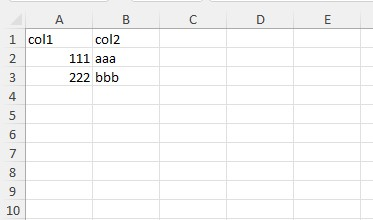

# Getting Started

[← Back to README](../README.md) | [Documentation index](../README.md#documentation) | [🇷🇺 Русский](ru/10-getting-started.md)

## Choosing an opening method

In 5.0, Excel is an opening facade; XML books use XlsxBook. See [migration](../UPGRADE.md).

| Method | Returns | Use |
|---|---|---|
| Excel::open($file, $options) | AbstractBook | Detect XLSX-family/XLS/ODS/CSV by content |
| Excel::openXlsx($file) | XlsxBook | Require XLSX, XLSM, XLTX or XLTM |
| Excel::openXls($file) | XlsBook | Require BIFF8 XLS |
| Excel::openOds($file) | OdsBook | Require ODS |
| Excel::openCsv($file, $options) / openCsvBook() | CsvBook | Common book/sheet API |
| Excel::openCsvReader($file, $options) | CsvReader | Low-level CSV engine |

CSV options accept an array, CsvOptions or null. Explicit CSV factories accept
empty files; generic open() rejects empty input. Only ['format' => 'csv'] forces
the format in open(). For low-level getCsvLine()/fromRow(), use openCsvReader()
or the existing CSV book's getReader().

isXlsx() checks supported XML workbook package parts and content types; a ZIP
signature alone is insufficient. isOds() checks the ODS MIME entry; isXls() checks
the OLE2 signature. validate() checks required XML-book/ODS parts and XML
well-formedness, not schemas or formula calculations. Macros are never executed.
Templates are read as saved documents.

Call $book->close() in finally to release handles and owned temporary files.
Closing is irreversible and idempotent; new reads and resuming a suspended row
iterator throw an exception. Caller-owned input streams remain open.

## Simple example

```php
use \avadim\FastExcelReader\Excel;

$file = __DIR__ . '/files/demo-00-simple.xlsx';

// Open a spreadsheet: the reader is chosen by the file signature, so XLSX,
// legacy XLS (Office 97-2003) and CSV are all opened the same way.
// See docs/21-xls.md and docs/20-csv.md for what differs per format.
$excel = Excel::open($file);
// Read all values as a flat array from current sheet
$result = $excel->readCells();
```
You will get this array:
```text
Array
(
    [A1] => 'col1'
    [B1] => 'col2'
    [A2] => 111
    [B2] => 'aaa'
    [A3] => 222
    [B3] => 'bbb'
)
```

```php
// Read all rows in two-dimensional array (ROW x COL)
$result = $excel->readRows();
```
You will get this array:
```text
Array
(
    [1] => Array
        (
            ['A'] => 'col1'
            ['B'] => 'col2'
        )
    [2] => Array
        (
            ['A'] => 111
            ['B'] => 'aaa'
        )
    [3] => Array
        (
            ['A'] => 222
            ['B'] => 'bbb'
        )
)
```

```php
// Read all columns in two-dimensional array (COL x ROW)
$result = $excel->readColumns();
```
You will get this array:
```text
Array
(
    [A] => Array
        (
            [1] => 'col1'
            [2] => 111
            [3] => 222
        )

    [B] => Array
        (
            [1] => 'col2'
            [2] => 'aaa'
            [3] => 'bbb'
        )

)
```

## Open from a string or a stream

A workbook does not have to live on disk. When the bytes are already in memory —
a database blob, an HTTP response body, an S3/Flysystem read — open them directly:

```php
// From a string (e.g. a BLOB column)
$excel = Excel::openString($blob);

// From an open stream resource (URL, php://memory, Flysystem read stream)
$stream = fopen('https://example.com/report.xlsx', 'rb');
$excel = Excel::openStream($stream);
fclose($stream); // the caller keeps ownership of the stream
```

Both pick the reader by signature exactly like `open()`, so a string or stream
holding XLSX, XLS or CSV reads back identically to the same file on disk. They
accept the same `$options` as `open()` (e.g. `['format' => 'csv']`). Internally
the content is copied to a temporary file, which is removed on script shutdown.


Streams are read from their current position without rewind; non-seekable inputs work.
The caller retains ownership of the input even on failure. Failed writes or copies
throw an exception and remove the created temporary file. Without an expected length
or checksum, the library cannot detect external truncation when the stream itself
reports a successful end of input.

`Excel::validate($file, $errors)` returns XML diagnostics for this call in `$errors`.
Missing required XLSX parts return false without XML errors; archive-open failures throw.
The `libxml_use_internal_errors` mode is restored; the shared libxml diagnostic buffer
is cleared before and after validation. Save earlier diagnostics first if you need them.

## See also

* [Reading Data](11-reading-data.md) — row by row, array keys, empty cells
* [Advanced Reading](12-advanced-reading.md) — read areas, defined names, callbacks
* [API Reference](90-api-reference.md)
